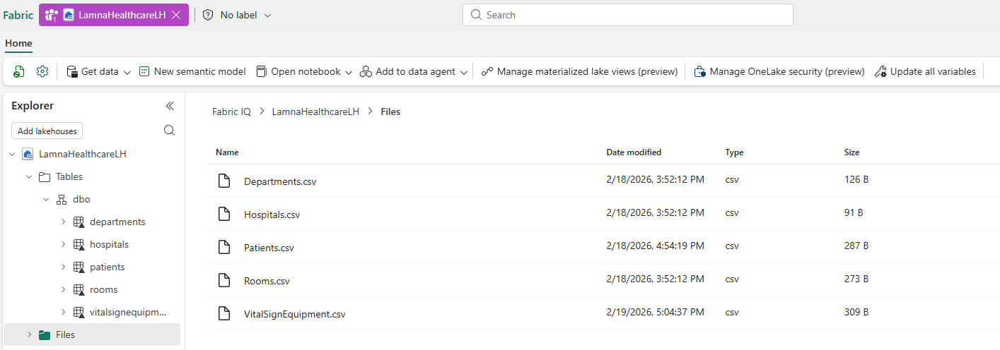

# Exercise 02: Create Lakehouse with Sample Data

[← Previous Exercise: Create Fabric Workspace](01-Create-Fabric-Workspace.md) | [Home](../README.md) | [Next Exercise: Create Eventhouse with Streaming Data →](03-Load-Healthcare-Data.md)

---

## Objective

Create a Microsoft Fabric Lakehouse named `LamnaHealthcareLH`, upload the healthcare sample data files, and convert them into Delta tables to form the basis of your ontology.

---

## Steps

### Step 1: Create Lakehouse
1. In your `LamnaHealthcareWS` workspace, select **+ New item > Lakehouse**.
2. Name the lakehouse `LamnaHealthcareLH` and select **Create**.
3. When the lakehouse opens, you will upload CSV files and convert them to tables.

### Step 2: Download and Load Healthcare Data Files
1. Download [sample-data.zip](https://github.com/MicrosoftLearning/mslearn-fabric/raw/main/Allfiles/Labs/23-24/sample-data.zip) and extract the CSV files to your local computer (or access them from the local repository `Data/` folder). The dataset contains:
   - `Hospitals.csv` - Healthcare facilities in your network
   - `Departments.csv` - Hospital departments (ICU, Emergency, Surgical)
   - `Rooms.csv` - Individual rooms within departments
   - `Patients.csv` - Current patients and their room assignments
   - `VitalSignEquipment.csv` - Monitoring equipment assigned to patients
   - `VitalSignsReadings.csv` - Actual patient vital sign measurements collected over time

2. Upload the five lakehouse files:
   - In the lakehouse, select **Get data > Upload files**.
   - Browse to and select these five files: `Hospitals.csv`, `Departments.csv`, `Rooms.csv`, `Patients.csv`, `VitalSignEquipment.csv`.
   - Select **Open** and then select **Upload** to upload all five files at once.
   - Wait for the upload to complete.

> [!NOTE]
> You will upload `VitalSignsReadings.csv` to an eventhouse in the next exercise, not to the lakehouse.

### Step 3: Convert Uploaded Files to Tables
1. In Explorer, select the **Files** folder where you see all five CSV files.
2. For each file, select the ellipsis (`...`) to the right of the file name and select **Load to Tables > New table**.
3. Configure each table using lowercase names without file extensions:
   - **Table name**: Use lowercase name (`hospitals`, `departments`, `rooms`, `patients`, `vitalsignequipment`)
   - **Column header**: Check **Use header for column names**
   - **Separator**: Leave as comma (`,`)
4. Select **Load**.
5. Repeat this process for all five files:

| File Name | Target Table Name | Column Header | Separator |
| :--- | :--- | :--- | :--- |
| `Hospitals.csv` | `hospitals` | Checked | Comma (`,`) |
| `Departments.csv` | `departments` | Checked | Comma (`,`) |
| `Rooms.csv` | `rooms` | Checked | Comma (`,`) |
| `Patients.csv` | `patients` | Checked | Comma (`,`) |
| `VitalSignEquipment.csv` | `vitalsignequipment` | Checked | Comma (`,`) |

---

## Validation

Verify you have five tables in the **Tables** section: `hospitals`, `departments`, `rooms`, `patients`, and `vitalsignequipment` as shown in the image below:

---

## Expected Result

Five Delta Lake tables (`hospitals`, `departments`, `rooms`, `patients`, `vitalsignequipment`) are loaded into `LamnaHealthcareLH`.

---

## Next Exercise

Proceed to [Exercise 03: Create Eventhouse with Streaming Data](03-Load-Healthcare-Data.md).
