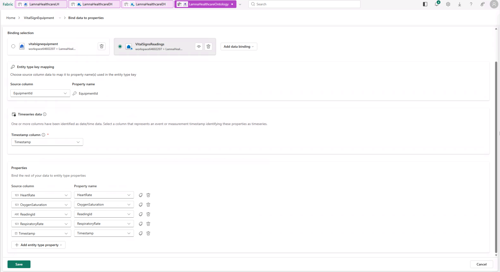
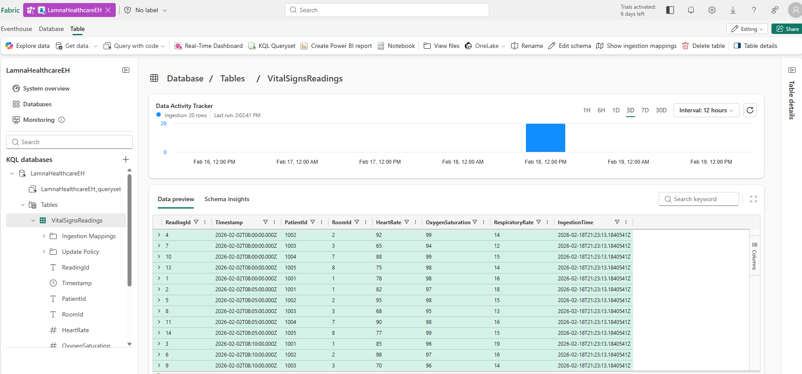

# Exercise 03: Load Healthcare Data

[← Previous Exercise: Create Lakehouse](02-Create-Lakehouse.md) | [Home](../README.md) | [Next Exercise: Create Ontology →](04-Create-Ontology.md)

---

## Objective

Upload the sample healthcare CSV datasets into the `LamnaHealthcareLH` lakehouse and convert them into Delta Lake tables for ontology binding.

---

## Steps

### Step 1: Upload CSV Files to Lakehouse
1. Open the `LamnaHealthcareLH` lakehouse in the Fabric portal.
2. In the left **Explorer** pane, select **Get data > Upload files** (or click the ellipsis `...` next to **Files** and select **Upload > Upload files**).
3. Browse to and select these five files from your local `Data/` folder:
   - `hospitals.csv`
   - `departments.csv`
   - `rooms.csv`
   - `patients.csv`
   - `vitalsignequipment.csv`

> [!NOTE]
> `vitalsignsreadings.csv` contains real-time time-series measurements (heart rate, oxygen saturation). In advanced scenarios, time-series data is ingested into an Eventhouse table rather than static lakehouse tables.

4. Select **Upload** to upload all five files.

### Step 2: Convert CSV Files to Tables
Convert each uploaded file into a Lakehouse table:

1. In Explorer under **Files**, select the ellipsis (`...`) next to `hospitals.csv`.
2. Select **Load to Tables > New table**.
3. Configure the table settings:
   - **Table name**: `hospitals`
   - **Column header**: Check **Use header for column names**
   - **Separator**: Comma (`,`)
4. Select **Load**.
5. Repeat this exact process for the remaining four files:

| File Name | Target Table Name | Column Header | Separator |
| :--- | :--- | :--- | :--- |
| `departments.csv` | `departments` | Checked | Comma (`,`) |
| `rooms.csv` | `rooms` | Checked | Comma (`,`) |
| `patients.csv` | `patients` | Checked | Comma (`,`) |
| `vitalsignequipment.csv` | `vitalsignequipment` | Checked | Comma (`,`) |

---

## Validation

1. Expand the **Tables** folder in the Explorer pane.
2. Verify you have five tables listed in lowercase:
   - `hospitals`
   - `departments`
   - `rooms`
   - `patients`
   - `vitalsignequipment`
3. Select the `patients` table to preview data. Confirm patient record `1001` (`Kerry Allen`) is visible.

---

## Expected Result

All five CSV files are converted into Delta Lake tables residing in `LamnaHealthcareLH`.

---

## Next Exercise

Proceed to [Exercise 04: Create Ontology](04-Create-Ontology.md).
