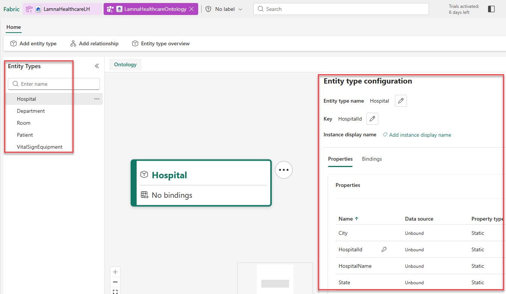

# Exercise 04: Create Ontology and Entity Types

[← Previous Exercise: Create Eventhouse with Streaming Data](03-Load-Healthcare-Data.md) | [Home](../README.md) | [Next Exercise: Create Relationship Types →](05-Configure-Relationships.md)

---

## Objective

Create an empty Fabric IQ ontology named `LamnaHealthcareOntology`, and define five entity types representing the healthcare domain (`Hospital`, `Department`, `Room`, `Patient`, `VitalSignEquipment`) with their properties and entity keys.

---

## Steps

### Step 1: Provision Ontology Item
1. In your `LamnaHealthcareWS` workspace, select **+ New item > Ontology (preview)**.
2. Name the ontology `LamnaHealthcareOntology` and select **Create**.
3. The ontology canvas opens, empty and ready for building your data model.

### Step 2: Create Hospital Entity Type
1. In the ontology ribbon, select **Add entity type**.
2. Enter `Hospital` as the entity type name and select **Add Entity Type**.
3. The `Hospital` entity type appears on the canvas.
4. With `Hospital` selected, select **View entity type details** in the ribbon to open its Configure page.
5. In the **Properties** section, expand **Manage property bindings** and select **Add properties**.
6. Add each property by entering details and selecting **+ Add**:
   - `HospitalId` (`Integer`)
   - `HospitalName` (`String`)
   - `City` (`String`)
   - `State` (`String`)
7. Select **Save**.
8. Select **Define entity type key**, choose `HospitalId` as the key, and select **Save**.
9. Select **Home** to return to the ontology canvas.

### Step 3: Create Remaining Entity Types
Follow the same process to create these four additional entity types with their properties and keys:

| Entity Type | Property Name | Property Type | Entity Type Key |
| :--- | :--- | :--- | :--- |
| **Department** | `DepartmentId` `DepartmentName` `HospitalId` `Floor` | `Integer` `String` `Integer` `Integer` | `DepartmentId` |
| **Room** | `RoomId` `RoomNumber` `DepartmentId` `RoomType` | `Integer` `String` `Integer` `String` | `RoomId` |
| **Patient** | `PatientId` `FirstName` `LastName` `DateOfBirth` `AdmissionDate` `CurrentRoomId` | `Integer` `String` `String` `DateTime` `DateTime` `Integer` | `PatientId` |
| **VitalSignEquipment** | `EquipmentId` `PatientId` `EquipmentType` `MonitoringStartDate` | `String` `Integer` `String` `DateTime` | `EquipmentId` |

---

## Validation

Verify that the **Entity Types** pane shows all five entity types, and that properties and entity type key have been defined for each entity as shown in the image below:

---

## Expected Result

`LamnaHealthcareOntology` is created with five entity types (`Hospital`, `Department`, `Room`, `Patient`, `VitalSignEquipment`) configured with property types and primary keys.

---

## Next Exercise

Proceed to [Exercise 05: Create Relationship Types](05-Configure-Relationships.md).
