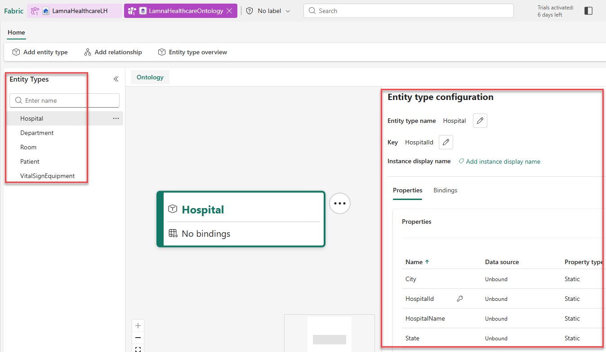

# Exercise 05: Create Entity Types

[← Previous Exercise: Create Ontology](04-Create-Ontology.md) | [Home](../README.md) | [Next Exercise: Create Relationship Types →](06-Configure-Relationships.md)

---

## Objective

Create five entity types representing the healthcare domain (`Hospital`, `Department`, `Room`, `Patient`, `VitalSignEquipment`), define their properties, and set primary entity keys.

---

## Steps

### Step 1: Create Hospital Entity Type
1. In the ontology ribbon, select **Add entity type**.
2. Enter `Hospital` as the entity type name and select **Add Entity Type**.
3. With `Hospital` selected, select **View entity type details** in the ribbon to open its configuration page.
4. In the **Properties** section, expand **Manage property bindings** and select **Add properties**.
5. Add each property by entering details and selecting **+ Add**:
   - `HospitalId` (Integer)
   - `HospitalName` (String)
   - `City` (String)
   - `State` (String)
6. Select **Save**.
7. Select **Define entity type key**, choose `HospitalId` as the key, and select **Save**.
8. Select **Home** to return to the ontology canvas.

### Step 2: Create Remaining Entity Types
Follow the same process to create the remaining four entity types with their properties and keys:

#### `Department`
- **Name**: `Department`
- **Properties**: `DepartmentId` (Integer), `DepartmentName` (String), `HospitalId` (Integer), `Floor` (Integer)
- **Entity Key**: `DepartmentId`

#### `Room`
- **Name**: `Room`
- **Properties**: `RoomId` (Integer), `RoomNumber` (String), `DepartmentId` (Integer), `RoomType` (String)
- **Entity Key**: `RoomId`

#### `Patient`
- **Name**: `Patient`
- **Properties**: `PatientId` (Integer), `FirstName` (String), `LastName` (String), `DateOfBirth` (String), `AdmissionDate` (String), `CurrentRoomId` (Integer)
- **Entity Key**: `PatientId`

#### `VitalSignEquipment`
- **Name**: `VitalSignEquipment`
- **Properties**: `EquipmentId` (String), `PatientId` (Integer), `EquipmentType` (String), `MonitoringStartDate` (String)
- **Entity Key**: `EquipmentId`

---

## Validation

Verify that the **Entity Types** pane shows all five entity types, and that properties and entity type key have been defined for each entity as shown in the image below:

---

## Expected Result

Five domain entity types with defined keys and properties appear in `LamnaHealthcareOntology`.

---

## Next Exercise

Proceed to [Exercise 06: Create Relationship Types](06-Configure-Relationships.md).
