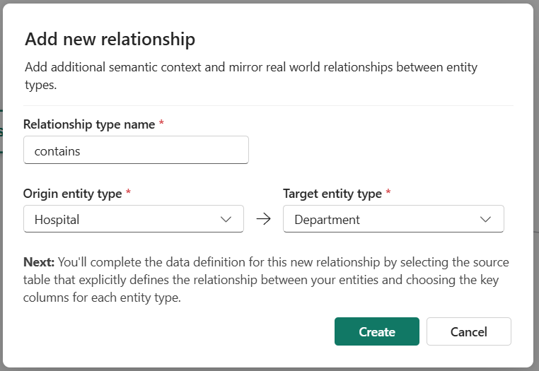

# Exercise 05: Create Relationship Types

[← Previous Exercise: Create Ontology and Entity Types](04-Create-Ontology.md) | [Home](../README.md) | [Next Exercise: Bind Entity Types to Data →](06-Bind-Ontology-Data.md)

---

## Objective

Create relationship types that model healthcare domain connections: `Hospital` → `Department` → `Room` → `Patient`, with `VitalSignEquipment` monitoring `Patient` and located in `Room`.

---

## Steps

### Step 1: Create Hospital-Department Relationship
1. In the ribbon, select **Add relationship**.
2. In the **Add relationship type to ontology** dialog, configure:
   - **Relationship type name**: `contains`
   - **Origin entity type**: `Hospital`
   - **Target entity type**: `Department`
3. Select **Create**.

The `contains` relationship dialog configuration is shown in the image below:

### Step 2: Create Remaining Relationships
Follow the same process to create these four additional relationships:

| Relationship Name | Origin Entity Type | Target Entity Type | Description |
| :--- | :--- | :--- | :--- |
| `has` | `Department` | `Room` | Department has rooms |
| `assignedTo` | `Patient` | `Room` | Patient is assigned to room |
| `monitors` | `VitalSignEquipment` | `Patient` | Equipment monitors patient |
| `locatedIn` | `VitalSignEquipment` | `Room` | Equipment is located in room |

---

## Validation

Verify that your ontology canvas displays all entity nodes and connecting relationship lines as shown in the image below:

---

## Expected Result

The ontology structure is complete with 5 entity types connected by 5 semantic relationship lines.

---

## Next Exercise

Proceed to [Exercise 06: Bind Entity Types to Data](06-Bind-Ontology-Data.md).
