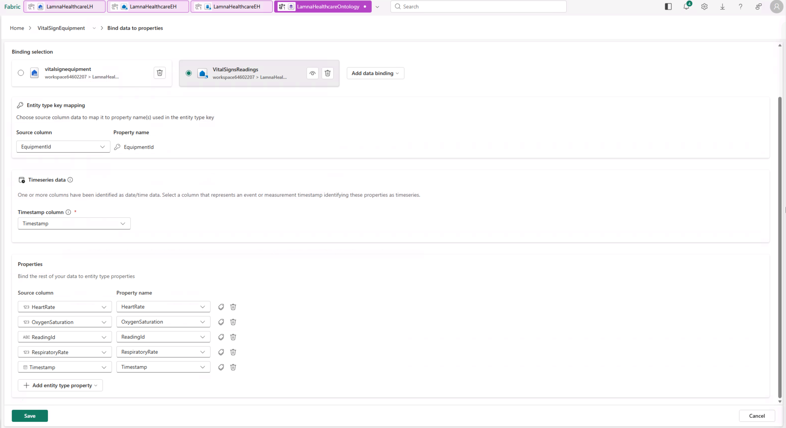

# Exercise 06: Bind Entity Types to Data & Configure Relationships

[← Previous Exercise: Create Relationship Types](05-Configure-Relationships.md) | [Home](../README.md) | [Next Exercise: Preview the Ontology →](07-Test-Ontology.md)

---

## Objective

Bind entity properties to actual data sources (static Lakehouse Delta tables and time-series Eventhouse tables) and configure relationship key mappings.

---

## Steps

### Step 1: Bind Static Lakehouse Data

#### 1. Bind `Hospital` Entity
1. Select `Hospital` on the canvas, select the ellipsis (`...`) next to its name, and select **Bind data**.
2. Select **Add data binding > Lakehouse table**. Select `LamnaHealthcareLH` and select **Next**.
3. Select the `hospitals` table and select **Select**.
4. For Binding type, keep **Static**.
5. Map properties to columns:
   - `HospitalId` → `HospitalId`
   - `HospitalName` → `HospitalName`
   - `City` → `City`
   - `State` → `State`
6. Select **Save**.

#### 2. Bind `Department`, `Room`, and `Patient` Entities
Follow the same process for static bindings:
- **`Department`**: Select `departments` table. Map `DepartmentId`, `DepartmentName`, `HospitalId`, `Floor`.
- **`Room`**: Select `rooms` table. Map `RoomId`, `RoomNumber`, `DepartmentId`, `RoomType`.
- **`Patient`**: Select `patients` table. Map `PatientId`, `FirstName`, `LastName`, `DateOfBirth`, `AdmissionDate`, `CurrentRoomId`.

---

### Step 2: Bind VitalSignEquipment Static & Time-Series Data

#### 1. Bind Static Equipment Data
1. Select `VitalSignEquipment` > **Bind data > Add data binding > Lakehouse table**.
2. Select `LamnaHealthcareLH` > `vitalsignequipment` table.
3. Map static properties (`EquipmentId`, `PatientId`, `EquipmentType`, `MonitoringStartDate`, `RoomId`).
4. Select **Save**.

#### 2. Bind Time-Series Vital Signs Data
1. Select `VitalSignEquipment` > **Bind data > Add data binding > Eventhouse table**.
2. Select `LamnaHealthcareEH` > `VitalSignsReadings` table.
3. Under Timeseries data, select `Timestamp`.
4. Verify key mapping (`EquipmentId` auto-matched).
5. Map time-series measurement columns:
   - `ReadingId` → `ReadingId`
   - `Timestamp` → `Timestamp`
   - `HeartRate` → `HeartRate`
   - `OxygenSaturation` → `OxygenSaturation`
   - `RespiratoryRate` → `RespiratoryRate`
6. Select **Save**.

---

### Step 3: Configure Relationship Key Mappings

On the ontology canvas, configure key column mappings for each relationship:

| Relationship Name | Origin Entity | Target Entity | Column Mapping |
| :--- | :--- | :--- | :--- |
| `contains` | `Hospital` | `Department` | `HospitalId` = `HospitalId` |
| `has` | `Department` | `Room` | `DepartmentId` = `DepartmentId` |
| `assignedTo` | `Patient` | `Room` | `CurrentRoomId` = `RoomId` |
| `monitors` | `VitalSignEquipment` | `Patient` | `PatientId` = `PatientId` |
| `locatedIn` | `VitalSignEquipment` | `Room` | `RoomId` = `RoomId` |

1. Click the `contains` relationship line on the canvas.
2. Select `HospitalId` on Hospital and `DepartmentId` on Department. Select **Save**.
3. Repeat for remaining four relationships.

---

## Validation

1. Confirm all 5 entity types display bound status icons.
2. Confirm all 5 relationship lines display configured mapping indicators.

---

## Expected Result

All entities and relationships in `LamnaHealthcareOntology` are bound to physical data tables.

---

## Next Exercise

Proceed to [Exercise 07: Preview the Ontology](07-Test-Ontology.md).
