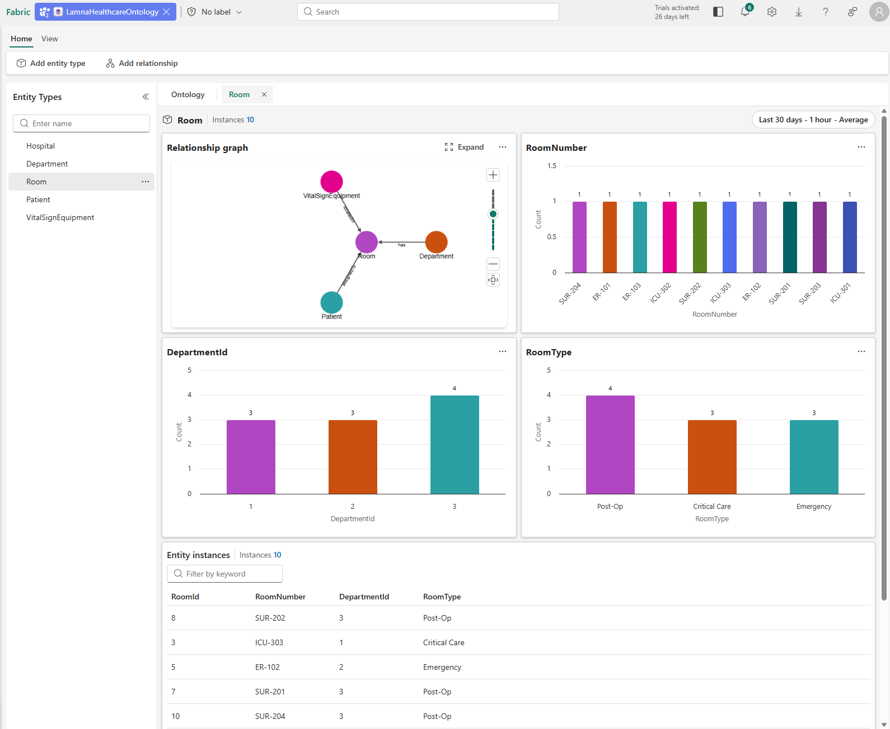

# Exercise 07: Preview the Ontology & Query Builder

[← Previous Exercise: Bind Entity Types to Data](06-Bind-Ontology-Data.md) | [Home](../README.md) | [Next Exercise: Create AI Agent →](08-Create-AI-Agent.md)

---

## Objective

Validate `LamnaHealthcareOntology` schemas, inspect graph connections via the Relationship Graph, run traversal queries in the Fabric IQ Query Builder focused on `PatientId 1001`, and inspect properties using Card View.

---

## Steps

### Step 1: Save and Preview Ontology
1. In the `LamnaHealthcareOntology` ribbon, select **Save**.
2. Select **Room** (or **Patient**) from the Entity Types list.
3. In the ontology ribbon, select **Entity type overview**.
4. After background processing completes, refresh the browser page to display the entity overview.
5. Review the overview sections:
   - **Relationship graph**: Visual representation connecting `Patient`, `Room`, `Department`, and `VitalSignEquipment`.
   - **Property charts**: Value distributions for entity properties.
   - **Entity instances table**: List of individual records.



---

### Step 2: Test Entity Graph Traversal
1. Open the **Patient** entity type.
2. Select the instance `PatientId 1001` (`Kerry Allen`).
3. Open the **Relationship Graph**.
4. Select **Expand** to expand the relationships connected to Patient 1001.

You should see the related entities and relationships in the graph canvas:

```text
VitalSignEquipment
        │
     monitors
        │
        ▼
     Patient
        │
    assignedTo
        │
        ▼
      Room
```

For `PatientId 1001`, the graph should resolve relationships to:
- **Patient**: Kerry Allen (`1001`)
- **Room**: Room 1 / `ICU-301`
- **VitalSignEquipment**: `VS-1001`

> [!NOTE]
> **Why this matters:** The Relationship Graph provides a visual way to verify that the ontology understands the connections between entities rather than treating each table as isolated data.

---

### Step 3: Test the Ontology Using Query Builder

After expanding the graph:
1. Select **Query Builder** from the top ribbon.
2. Select **Add filter**.
3. Configure the filter details:

| Setting | Value |
| :--- | :--- |
| **Entity** | `Patient` |
| **Property** | `PatientId` |
| **Condition** | `Equals` |
| **Value** | `1001` |

4. Select **Run query**.

The query returns the graph associated with `PatientId 1001`:

```text
                 ┌──────────────────────┐
                 │ VitalSignEquipment   │
                 │ VS-1001              │
                 └──────────┬───────────┘
                            │
                         monitors
                            │
                            ▼
                    ┌──────────────┐
                    │   Patient    │
                    │ Kerry Allen  │
                    │ ID: 1001     │
                    └──────┬───────┘
                           │
                       assignedTo
                           │
                           ▼
                    ┌──────────────┐
                    │     Room     │
                    │ Room ID: 1   │
                    │ ICU-301      │
                    └──────────────┘
```

---

### Step 4: Switch to Card View

After running the query:
1. Open **Diagram view** from the view selector.
2. Select **Card view**.

The result is displayed as cards containing detailed entity information. This makes it easy to inspect actual properties of returned entities rather than only viewing relationship lines.

For example, the **Patient** card displays:
```text
Patient
--------------------
PatientId: 1001
FirstName: Kerry
LastName: Allen
DateOfBirth: 1965-03-15
AdmissionDate: 2026-01-28
CurrentRoomId: 1
```

The related **VitalSignEquipment** card displays:
```text
VitalSignEquipment
--------------------
EquipmentId: VS-1001
PatientId: 1001
EquipmentType: Continuous Monitoring
RoomId: 1
```

The related **Room** card displays:
```text
Room
--------------------
RoomId: 1
RoomNumber: ICU-301
Type: Critical Care
```

---

### Step 5: Validate the Ontology

Verify that the query correctly resolves the following information:

| Entity / Property | Expected Value |
| :--- | :--- |
| **PatientId** | `1001` |
| **Patient** | Kerry Allen |
| **Assigned Room** | `1` / `ICU-301` |
| **Monitoring Equipment** | `VS-1001` |
| **Equipment Type** | Continuous Monitoring |

> [!IMPORTANT]
> The key advantage is that information is retrieved dynamically through ontology entities and semantic graph relationships, without needing manual SQL joins across underlying Lakehouse tables.

---

## Expected Result

`PatientId 1001` correctly resolves across all graph relationship hops (`Patient` → `Room` → `Equipment` → `Department`), returning validated entity properties in both Diagram and Card views.

---

## Next Exercise

Proceed to [Exercise 08: Create AI Agent with Fabric IQ Ontology](08-Create-AI-Agent.md).
