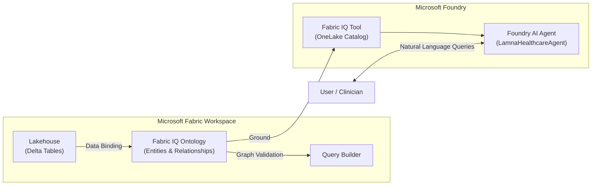

# Build an AI Agent with Microsoft Fabric IQ, Ontology, and Microsoft Foundry

Welcome to the **Build an AI Agent with Microsoft Fabric IQ, Ontology, and Microsoft Foundry** hands-on workshop repository!

This workshop guides data engineers, AI developers, and solution architects through building an end-to-end intelligent agentic workflow for a fictional healthcare provider called **Lamna Healthcare**. You will transform raw tabular healthcare datasets into a rich, graph-based domain ontology in **Microsoft Fabric IQ**, connect that ontology to a **Microsoft Foundry AI Agent** via the **Fabric IQ (OneLake Catalog)** tool, and interact with a grounded AI Agent capable of answering complex domain questions.

---

## Workshop Overview

Modern healthcare organizations store operational data across multiple structured tables (patients, rooms, departments, equipment). Querying across these disparate sources traditionally requires complex SQL joins or custom graph schemas.

In this workshop, you will:
1. Load healthcare data into a **Microsoft Fabric Lakehouse**.
2. Construct a **Fabric IQ Ontology** modeling hospitals, departments, rooms, patients, and vital sign monitoring equipment.
3. Bind tabular Lakehouse data to domain entities and establish semantic graph relationships.
4. Ground a **Microsoft Foundry AI Agent** using the **Fabric IQ (OneLake Catalog)** tool connected to your `LamnaHealthcareOntology`.
5. Interact with the AI Agent in natural language to query patient context, room assignments, and active monitoring equipment.

```
Healthcare Data (CSVs)
  └─► Microsoft Fabric Lakehouse & Eventhouse
        └─► Fabric IQ Ontology (Entities & Relationships)
              └─► Fabric IQ Query Builder Validation
                    └─► Microsoft Foundry AI Agent (Fabric IQ OneLake Tool)
```

---

## Learning Objectives

By completing this workshop, participants will be able to:
- **Configure Fabric Capacity & Tenant Settings** required for Fabric IQ Ontology and Graph experiences.
- **Build a Fabric Lakehouse** and import relational healthcare datasets.
- **Design Domain Ontologies** in Fabric IQ with custom Entity Types, Entity Keys, and Property Bindings.
- **Model Graph Relationships** (e.g., `contains`, `has`, `assignedTo`, `monitors`, `locatedIn`).
- **Validate & Traversal Test** ontologies using the Fabric IQ Relationship Graph and Query Builder.
- **Integrate Fabric IQ with Microsoft Foundry** by attaching your Fabric IQ Ontology item as an Agent Tool via OneLake Catalog.
- **Construct & Test Grounded AI Agents** in Microsoft Foundry with targeted system instructions and safety constraints.

---

## Architecture & Data Flow

Below is the end-to-end system architecture for the Lamna Healthcare solution:



For complete architectural diagrams and entity-relationship specifications, see [`architecture.md`](architecture.md).

---

## Technologies Used

- **Microsoft Fabric**: Lakehouse, Delta Tables, Fabric IQ Ontology (Preview), Query Builder.
- **Microsoft Foundry (Azure AI Foundry)**: Fabric IQ (OneLake Catalog) Tool, Agent Service, Model Deployments.
- **Data Formats**: CSV, Delta Lake format.
- **Modeling**: Knowledge Graphs, Domain Ontologies, Entity-Relationship Mapping.

---

## Prerequisites

Before starting the exercises, verify that your environment satisfies all setup requirements outlined in [`prerequisites.md`](prerequisites.md):

1. **Microsoft Fabric Capacity**: Active Fabric Trial or paid Fabric Capacity (F64+ recommended).
2. **Fabric Tenant Settings**:
   - `Enable Ontology item (preview)` set to Enabled.
   - `User can create Graph (preview)` set to Enabled.
3. **Microsoft Foundry Access**: Azure Subscription with access to Microsoft Foundry (`https://ai.azure.com`).
4. **Workshop Datasets**: Available in the [`Data/`](Data/) directory.

---

## Important Preview Limitations

> [!IMPORTANT]
> **Preview Status:** Microsoft Fabric IQ Ontology and Microsoft Foundry AI features are currently in public preview. Interface navigation, menu labels, and portal configurations may vary as Microsoft updates these services.

---

## Workshop Modules & Exercises

The workshop consists of 11 step-by-step hands-on exercises:

| Exercise | Description | Focus Area |
| :--- | :--- | :--- |
| [**00-Prerequisites**](Exercises/00-Prerequisites.md) | Verify Fabric tenant settings, capacities, and Foundry permissions. | Environment Validation |
| [**01-Create-Fabric-Workspace**](Exercises/01-Create-Fabric-Workspace.md) | Create a dedicated Fabric Workspace (`LamnaHealthcareWS`). | Infrastructure Setup |
| [**02-Create-Lakehouse**](Exercises/02-Create-Lakehouse.md) | Provision `LamnaHealthcareLH` lakehouse, upload CSVs, and load Delta tables. | Data Lakehouse |
| [**03-Load-Healthcare-Data**](Exercises/03-Load-Healthcare-Data.md) | Provision `LamnaHealthcareEH` eventhouse and ingest time-series data. | Streaming Data Ingestion |
| [**04-Create-Ontology**](Exercises/04-Create-Ontology.md) | Provision `LamnaHealthcareOntology` and configure domain entity types and keys. | Semantic & Entity Modeling |
| [**05-Configure-Relationships**](Exercises/05-Configure-Relationships.md) | Define graph relationships (`contains`, `has`, `assignedTo`, `monitors`, `locatedIn`). | Graph Modeling |
| [**06-Bind-Ontology-Data**](Exercises/06-Bind-Ontology-Data.md) | Bind entity types and properties to Lakehouse and Eventhouse tables. | Data Binding |
| [**07-Test-Ontology**](Exercises/07-Test-Ontology.md) | Preview ontology overview, relationship graph, and run Query Builder tests. | Ontology Validation |
| [**08-Create-AI-Agent**](Exercises/08-Create-AI-Agent.md) | Create Foundry Project, AI Agent (`LamnaHealthcareAgent`), and attach Fabric IQ tool. | Agent Engineering |
| [**09-Test-Agent**](Exercises/09-Test-Agent.md) | Run test query scenarios against `PatientId 1001` to evaluate agent performance. | Agent Testing & Validation |
| [**10-Clean-Up-Resources**](Exercises/10-Clean-Up-Resources.md) | Clean up Fabric workspace and Microsoft Foundry project resources (optional). | Resource Clean Up |

---

## Expected Final Outcome

Upon completing Exercise 09, you will have a fully functioning **LamnaHealthcareAgent** running in Microsoft Foundry that can respond accurately to clinical data questions grounded directly in your Fabric IQ Ontology:

```text
User: Show the room and monitoring equipment associated with PatientId 1001.

LamnaHealthcareAgent:
Based on the Lamna Healthcare Fabric IQ Ontology:
- Patient: Kerry Allen (PatientId: 1001)
- Room Assigned: Room 1 (RoomNumber: ICU-301, Department: Intensive Care Unit, Floor 3)
- Monitoring Equipment: Continuous Monitoring (EquipmentId: VS-1001, Monitoring Started: 2026-02-01)
```
