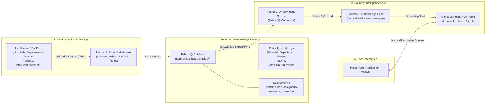
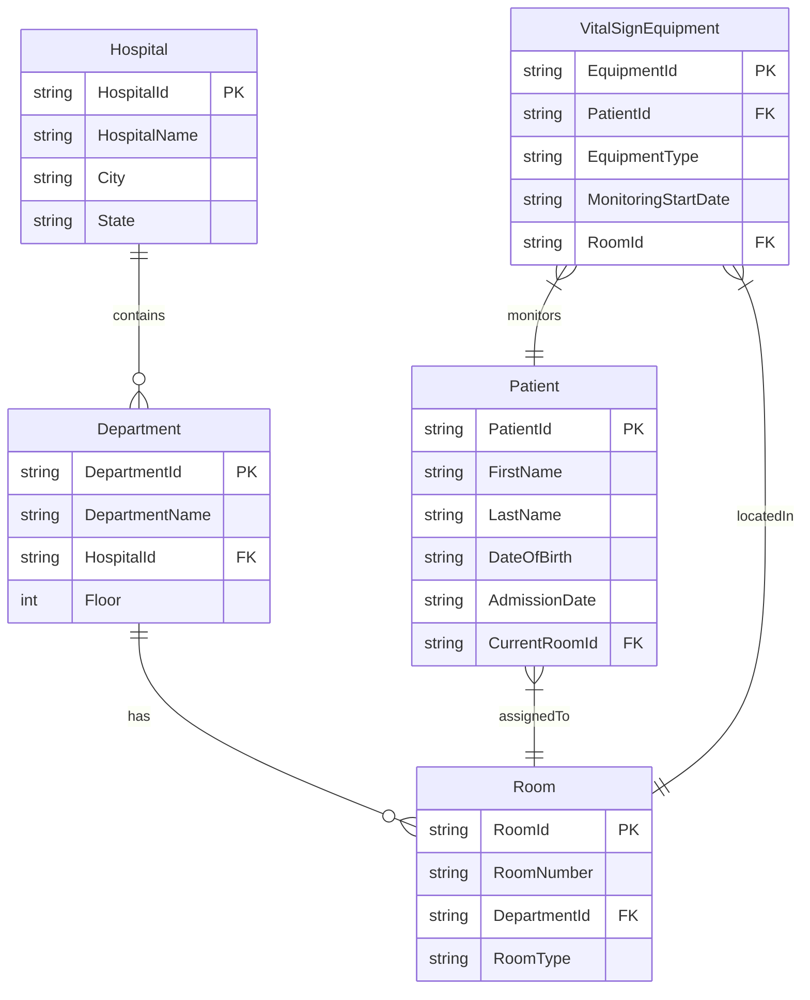

# Architecture & Data Flow Overview

This document describes the architectural flow and domain model for the **Lamna Healthcare** workshop solution, integrating **Microsoft Fabric IQ**, **Fabric Lakehouse**, **Ontology**, and **Microsoft Foundry Agent Service**.

---

## 1. End-to-End System Architecture

The workshop builds an end-to-end knowledge and agentic intelligence pipeline that connects raw operational healthcare tables to natural language conversational agents.

---

## 2. Lamna Healthcare Ontology Domain Model

The **Lamna Healthcare** domain model formalizes operational entities and their relationships, enabling graph traversal and context-aware reasoning for the AI Agent.

---

## 3. Key Components & Responsibilities

| Component | Technology | Primary Function |
| :--- | :--- | :--- |
| **Data Lakehouse** | Microsoft Fabric Lakehouse | Stores raw CSV data as Delta Lake tables (`hospitals`, `departments`, `rooms`, `patients`, `vitalsignequipment`). |
| **Semantic Data Layer** | Fabric IQ Ontology | Maps tabular Delta tables into domain entities, properties, keys, and graph relationships. |
| **Graph Query Engine** | Fabric IQ Query Builder | Validates ontology traversal (e.g. `PatientId 1001` → `Room` → `Equipment`). |
| **Knowledge Grounding** | Foundry IQ Knowledge Base | Connects Fabric IQ Ontology entities into Microsoft Foundry for enterprise RAG and reasoning. |
| **AI Agent** | Microsoft Foundry Agent | Uses system instructions and grounding tools to execute reasoning queries over healthcare data. |

---

## Quick Navigation

[← Back to README](README.md) | [View Prerequisites](prerequisites.md) | [Start Exercise 00 →](Exercises/00-Prerequisites.md)
